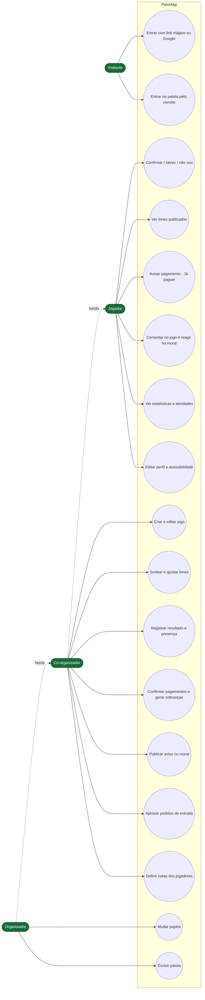
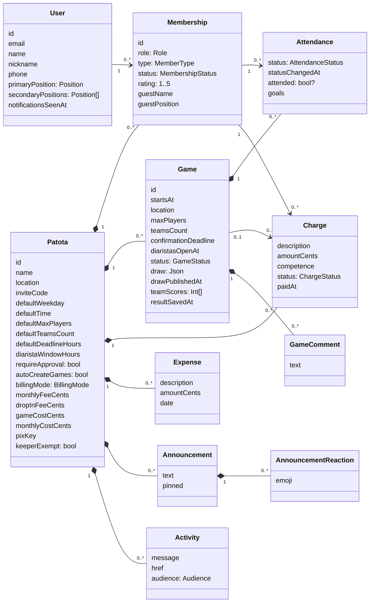
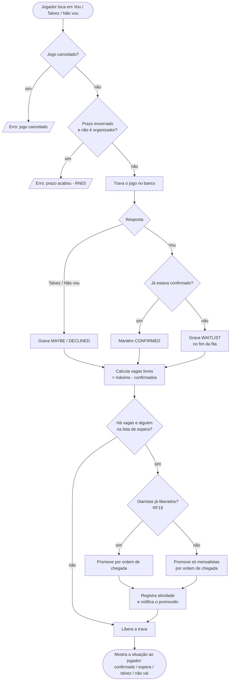
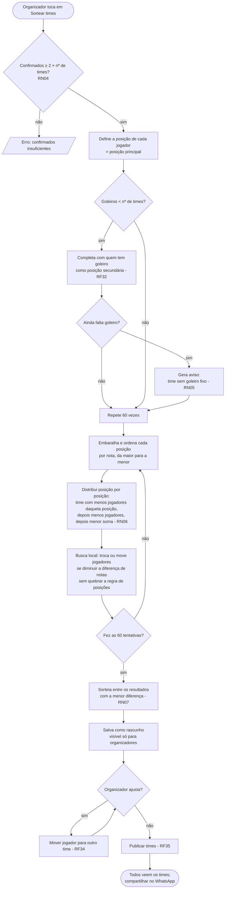
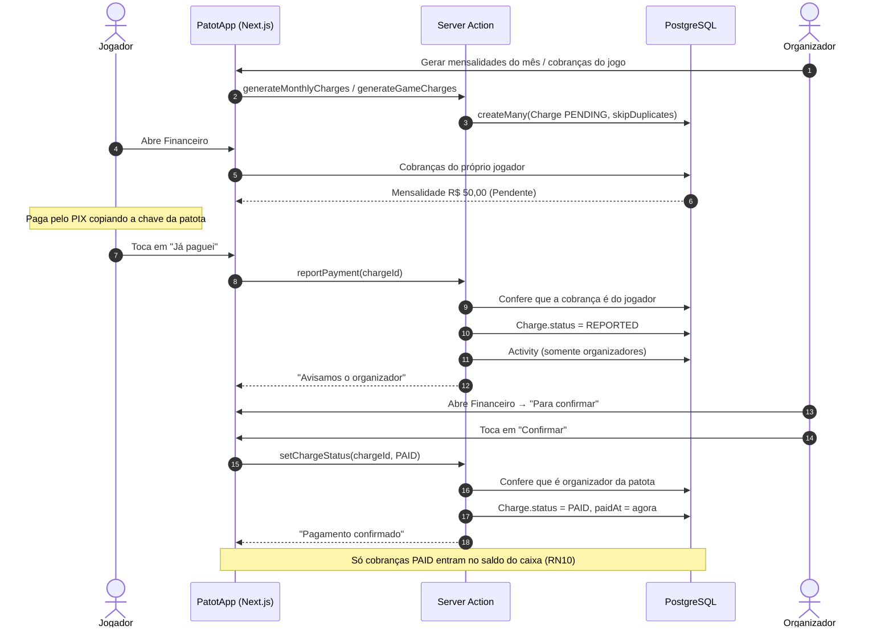

# PatotApp — Especificação e Análise (UML)

Diagramas da etapa 11 do projeto de extensão, feitos a partir do código implementado (`prisma/schema.prisma`, `src/domain/*` e as server actions em `src/app/(app)/**/actions.ts`). Os códigos RF/RN/RNF remetem a [01-requisitos.md](01-requisitos.md).

Os diagramas estão em [Mermaid](https://mermaid.js.org/) e aparecem desenhados no GitHub. Para exportar como imagem para o relatório, cole o código em https://mermaid.live.

---

## 1. Diagrama de casos de uso

O Mermaid não tem diagrama de casos de uso nativo. Por isso, ele foi desenhado como fluxograma: atores à esquerda e casos de uso em elipses. A herança entre atores mostra que o **Co-organizador** faz tudo o que o **Jogador** faz e mais a gestão do dia a dia, e que o **Organizador** soma a isso as ações sensíveis.

| Caso de uso | Requisitos |
|---|---|
| Entrar com link mágico ou Google | RF01, RF02 |
| Entrar na patota pelo convite / aprovar pedidos | RF09, RF10 |
| Confirmar presença | RF18, RF19, RF20 |
| Sortear e ajustar times / ver times | RF29–RF35 |
| Registrar resultado / estatísticas | RF52, RF53 |
| Pagamentos e cobranças | RF37–RF45 |
| Mural, comentários, atividades | RF46–RF49 |
| Notas dos jogadores | RF26, RF27 |
| Papéis e exclusão | RF11, RN02 |

---

## 2. Diagrama de classes (modelo de dados)

Mostra as entidades persistidas. Os modelos internos do Auth.js (`Account`, `Session`, `VerificationToken`) foram omitidos. O papel, o tipo, a nota e a situação de cada pessoa ficam em **Membership**, porque são *por patota* (RF26). Um convidado sem conta é um `Membership` sem `User` (RF13).

Enumerações: `Position` (GOL, ZAG, LAT, MEI, ATA) · `Role` (ORGANIZER, CO_ORGANIZER, PLAYER) · `MemberType` (MENSALISTA, DIARISTA) · `MembershipStatus` (ACTIVE, PENDING) · `AttendanceStatus` (CONFIRMED, MAYBE, DECLINED, WAITLIST) · `GameStatus` (SCHEDULED, CANCELLED) · `BillingMode` (FIXED_MONTHLY, SPLIT_PER_GAME) · `ChargeStatus` (PENDING, REPORTED, PAID, WAIVED) · `Audience` (ALL, MANAGERS).

Valores em dinheiro são inteiros em centavos (RNF24).

---

## 3. Diagrama de atividades — confirmação de presença com lista de espera

Implementado em `respond()` (`src/app/(app)/patotas/[id]/jogos/actions.ts`) e `fillSpots()` (`src/server/games.ts`), com as regras puras em `src/domain/attendance.ts`. Toda a parte entre a trava e a promoção roda numa **transação com trava por jogo** (`pg_advisory_xact_lock`). Assim, duas confirmações simultâneas não ultrapassam o limite de vagas (RF20).

Requisitos: RF18, RF19, RF20, RF22, RN03.

---

## 4. Diagrama de atividades — sorteio de times

Implementado em `drawTeams()` (`src/domain/draw.ts`), uma função pura testada com 150 elencos aleatórios.

Requisitos: RF29–RF35, RN04–RN07.

---

## 5. Diagrama de sequência — pagamento

Fluxo "Já paguei" → confirmação do organizador (RF41, RN10). O pagamento em si acontece fora do app, por PIX (RF42). O app só registra os estados da cobrança.

---

## 6. Rastreabilidade

| Diagrama | Código principal |
|---|---|
| Casos de uso | `src/app/**` (rotas e server actions) |
| Classes | `prisma/schema.prisma` |
| Confirmação | `src/domain/attendance.ts`, `src/server/games.ts` |
| Sorteio | `src/domain/draw.ts`, `src/domain/teams.ts` |
| Pagamento | `src/app/(app)/patotas/[id]/financeiro/actions.ts`, `src/domain/billing.ts` |
